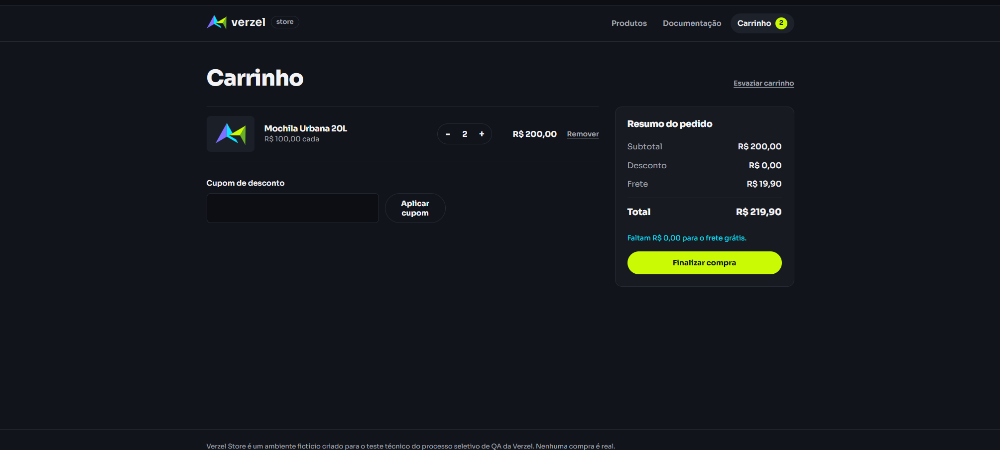

# Relatório de Testes Manuais e Bugs - Verzel Store

## 🐛 Bugs Encontrados

### 1. Falha de validação de Nome e E-mail no checkout
**Gravidade:** Alta (Permite dados corrompidos/falsos)
**Ambiente:** Web 

**Descrição:** 
O formulário na página "Finalizar compra" não valida corretamente o formato dos dados inseridos pelo utilizador. É possível avançar com o pedido utilizando um nome contendo apenas números e um e-mail com estrutura inválida.

**Passos para reproduzir:**
1. Adicionar um produto ao carrinho e avançar para "Finalizar compra".
2. Preencher o campo "Nome completo" apenas com números (ex: `111111111 111111111`).
3. Preencher o campo "E-mail" com um formato incorreto (ex: `.@Kma21.k`).
4. Preencher o "CEP" com um valor válido.
5. Clicar em "Confirmar pedido".

**Comportamento Atual:**
O sistema aceita a confirmação do pedido, ignorando a formatação incorreta do nome e do e-mail.

**Comportamento Esperado:**
O sistema deve bloquear a submissão e exibir mensagens de erro informando que o e-mail precisa de ter um formato válido (ex: `texto@dominio.com`) e que o nome não pode ser composto apenas por números.

**Evidência:**
[📹 Clique aqui para assistir ao vídeo: Falha de validação no checkout](./evidencias/bug-checkout-dados.mp4)

---

### 2. Frete grátis não é aplicado no valor exato de R$ 200,00
**Gravidade:** Alta (Impacta financeiramente o cliente e viola regra de negócio)
**Ambiente:** Web / API

**Descrição:** 
O sistema não está a aplicar a isenção de frete quando o subtotal do carrinho atinge exatamente R$ 200,00, violando o critério de aceite CA06 que determina que o valor é "inclusive".

**Passos para reproduzir:**
1. Aceder à página inicial da loja.
2. Adicionar produtos que totalizem exatamente R$ 200,00 (ex: 2x Mochila Urbana 20L a R$ 100,00 cada).
3. Navegar para o carrinho de compras.
4. Observar o valor cobrado na linha "Frete".

**Comportamento Atual:**
O sistema cobra o frete padrão de R$ 19,90, e exibe a mensagem indicando que faltam R$ 0,00 para o frete grátis.

**Comportamento Esperado:**
O sistema deve reconhecer o valor limiar e aplicar o frete grátis (R$ 0,00), de acordo com a regra de que o benefício começa a partir de R$ 200,00 inclusive.

**Evidência:**

---

### 3. Falta de feedback visual/redirecionamento ao adicionar produto
**Gravidade:** Média (Impacta a experiência do utilizador)
**Ambiente:** Web

**Descrição:** 
Quando o utilizador clica no botão "Adicionar ao carrinho" na página inicial, o produto é adicionado (o contador do carrinho atualiza), mas o cliente não é redirecionado para a página do carrinho, nem recebe um alerta visual claro de que a ação foi bem-sucedida.

**Passos para reproduzir:**
1. Aceder à página inicial da loja.
2. Clicar em "Adicionar ao carrinho" em qualquer produto.
3. Observar o comportamento da interface.

**Comportamento Atual:**
O número no ícone do carrinho altera para "1", mas o utilizador permanece na página inicial sem nenhum feedback visual proeminente.

**Comportamento Esperado:**
O sistema deveria redirecionar o utilizador automaticamente para a página `/carrinho` ou exibir um Toast/Modal confirmando a adição do produto.

**Evidência:**
[📹 Clique aqui para assistir ao vídeo: Falta de feedback visual](./evidencias/bug-feedback.mp4)

---

## 🧪 Casos de Teste Manuais

### CT01: Validar frete grátis para compras a partir de R$ 200,00 (CA06)
**Objetivo:** Garantir que o sistema zera o valor do frete quando o subtotal ultrapassa R$ 200,00.
**Pré-condições:** O utilizador deve estar na página inicial com o carrinho completamente vazio.

**Passos:**
1. Aceder à página inicial da loja.
2. Adicionar o produto "Jaqueta Corta-Vento" (R$ 229,90) ao carrinho.
3. Navegar para a página do carrinho clicando no link superior.
4. Observar a linha correspondente ao "Frete" no resumo de valores.
5. Observar o valor em "Total".

**Resultado Esperado:**
- O valor do frete deve ser exibido como R$ 0,00.
- O total deve ser R$ 229,90 (igual ao subtotal).
- A mensagem indicando "faltam X reais para frete grátis" não deve ser exibida.
